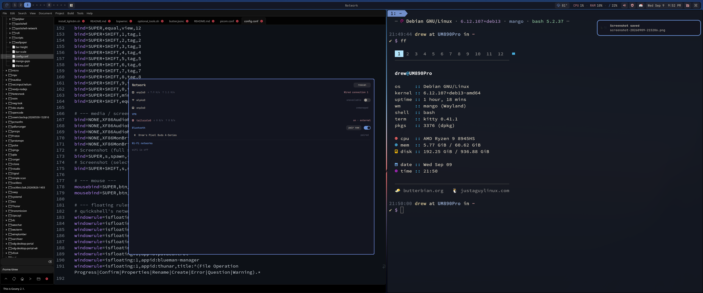

# 🥭 mangowc-setup


A MangoWC rice script for Debian 13 (trixie).
One script installs the compositor, the bar, and everything in between, drops
in the config, and you're tiling — with animations — on plain Debian stable.

> **Devuan port:** this fork accepts Devuan Excalibur (no systemd) — see
> [DEVUAN.md](DEVUAN.md) for the runit/sysvinit adaptations (elogind/seatd,
> per-init service handling, greetd recommendation).

> Part of the [JustAGuy Linux](https://justaguy.dev/drew) window manager collection — installable standalone or via [butterknife](https://justaguy.dev/drew/butterknife), the installer for [Butterbian](https://butterbian.org).



---

## 🤔 What is MangoWC?

[Mango](https://github.com/mangowm/mango) is a Wayland compositor built on
dwl — dwm's model, brought to Wayland. Tags instead of workspaces. Master and
stack, with a dozen other layouts a keypress away. A flat `key=value` config
that reloads while you watch.

Then it adds the part dwm never had: window animations, blur, shadows and
rounded corners, courtesy of [scenefx](https://github.com/wlrfx/scenefx).
Think **dwm's brain with Hyprland's face**, in a few thousand lines of C, and
no Hyprland.

---

## 🚀 Installation

```bash
sudo apt install git      # a minimal Debian doesn't have it
git clone https://justaguy.dev/drew/mangowc-setup.git
cd mangowc-setup
chmod +x install.sh
./install.sh
```

Then reboot and pick **Mango** at the login screen. On a machine that
already had a login screen, logging out all the way is enough (a group
membership changes), though a reboot is the sure way to get sound and
screen sharing started. The installer tells you which applies, and warns
if your wired connection is one NetworkManager won't manage yet.

```
Options:
  --only-config      Only copy config files (skip packages)
  --help             Show help message
```

Debian 13 (trixie) is the only base this has been tested on. Anything
else — forky, sid, Ubuntu and its derivatives — the installer refuses on
purpose. The reason is the wlroots pin, explained under **Why 0.14.4,
and Why the Pin** below.

> ⚠️ **NVIDIA: untested.** This setup has only been run on AMD
> hardware. The installer runs the same `nvidia-setup.sh` as sway-setup
> (kernel modesetting plus a couple of environment variables) when it
> detects the proprietary driver, and copies it to `~/nvidia-setup.sh`
> for re-runs. What nobody has verified is scenefx — blur, shadows, and
> rounded corners — on the proprietary driver. If you try it, a report
> either way is welcome.

Virtual machines: it runs, and the installer switches to a software cursor
so the pointer isn't upside down under virtio-gpu, but blur and animations
will crawl without a real GPU. Not a supported target.

### Updating

```bash
cd mangowc-setup
git pull
./install.sh
```

The installer asks before touching an existing `~/.config/mango`: say
**yes** to the backup and it moves the old folder aside as
`~/.config/mango.bak.<timestamp>`, then copies the new one in and installs
any packages that are new since last time. Nothing of yours is lost, but
two kinds of things live in that folder and have to be carried over by
hand:

- **Your edits to `config.conf`** — `monitorrule` lines, keybinds you
  changed, the wallpaper `exec-once` line. Diff the two files and copy
  across what's yours: `diff ~/.config/mango.bak.*/config.conf ~/.config/mango/config.conf`
- **Settings the bar keeps in small files** — kept monitor layouts, gaps,
  effects, bar size, lock style, weather location. One line brings them
  back:

```bash
B=$(ls -d ~/.config/mango.bak.* | tail -1)
cp -n "$B"/{displays.conf,mango-effects,mango-gaps,bar-height,bar-scale,popup-scale,lock-style,lock-idle,tag-icons,weather-location,weather-units,launcher-history} ~/.config/mango/ 2>/dev/null
```

Then pick your wallpaper again from the bar's wallpaper picker, which
regenerates the colour theme, and reload with `Super+Shift+R`. When a
pull changed only config, `./install.sh --only-config` does the same
without the package steps. Delete the backup folder once you're happy.

---

## 📦 What It Installs

trixie ships wlroots 0.18, and mango needs 0.19 plus scenefx. So the
compositor stack comes from [butterrepo](https://justaguy.dev/drew/butterrepo)
as proper `.deb`s, built in a clean trixie container by
[deb-builders](https://justaguy.dev/drew/deb-builders):

| Package (butterrepo)        | Purpose                                                        |
|-----------------------------|----------------------------------------------------------------|
| `mangowc`                   | The compositor — 0.14.4, built with 12 tags                    |
| `libwlroots-0.19`           | Its wlroots, side by side with Debian's 0.18 (sway keeps working) |
| `libscenefx-0.4`            | Blur, shadows, rounded corners                                 |
| `quickshell`                | The bar and every popup                                        |
| `rofi`                      | Launcher and power menu when the bar isn't running             |
| `awww`                      | Wallpaper daemon (the artist formerly known as swww) — wallpapers wipe in, they don't just appear |

Everything else is stock Debian:

| Component                     | Purpose                              |
|-------------------------------|--------------------------------------|
| `dunst`                       | Notifications (layer-shell native)   |
| `grim` + `slurp`              | Screenshots                          |
| `swappy`                      | Screenshot annotate (arrows, text, blur) |
| `cliphist` + `wl-clipboard`   | Clipboard history                    |
| `swayidle` + `wlopm`          | Monitor power-off after 15 min idle  |
| `xdg-desktop-portal-wlr/gtk`  | Screen sharing, file dialogs         |
| `x11-xserver-utils`           | `xhost`, so password-prompted root apps (Timeshift, GParted) can open a window |
| `build-essential`             | Compiler toolchain, as in the other setups (nothing here builds from source, but a desktop should be able to) |
| `kitty`                       | Terminal (via butterscripts)         |
| `geany`                       | Editor (via butterscripts): `Super + E`, and editing a bind from the keybinds viewer |
| `loupe`                       | Image viewer; follows the wallpaper theme like the GTK3 apps do |
| `thunar` + plugins            | File manager                         |
| `pipewire`                    | Audio                                |
| `nwg-look`                    | GTK configurator                     |
| `wlr-randr`                   | The Displays card: mode, scale, rotation, arrangement, kept across restarts and hotplug |
| `qml6-module-qtquick-effects` | The lock screen's blurred-wallpaper style (without it: the wallpaper dimmed) |
| `wlsunset`, `power-profiles-daemon`, `brightnessctl` | The command menu's toggles |
| `network-manager-config-connectivity-debian` | Lets the network icon tell "no internet" and hotel/café sign-in pages from a working connection |
| `btop`                        | The metrics card's full view         |
| `mpd-mpris` (butterrepo, optional) | MPD users: puts MPD on the media bus so the Media module, playerctl and media keys see it (`sudo apt install mpd-mpris && systemctl --user enable --now mpd-mpris`) |
| `qrencode`                    | The network app's Share Wi-Fi QR code |
| `fastfetch`                   | The launcher's "About this system"   |

> 💡 _Themes by [vinceliuice](https://github.com/vinceliuice) — Orchis (GTK) and Colloid (icons)._

---

## 📊 The Bar

The same quickshell shell that runs the dwm, bspwm and openbox setups, with a
mango backend. Tags, occupancy, urgency, focused title and layout come from a
single `mmsg watch` stream — no polling, no patch — and clicks go back through
`mmsg dispatch`.

| Module      | Left click               | Right click             | Scroll         |
|-------------|--------------------------|-------------------------|----------------|
| Launcher    | app launcher             | wallpaper picker        | —              |
| Tags        | view                     | —                       | cycle tags     |
| Layout      | layout + tweaks picker   | (empty bar: same)       | cycle layouts  |
| Media       | play / pause             | now-playing popup       | prev / next    |
| Weather     | 3-day forecast + radar   | location / units        | —              |
| CPU / RAM   | meters, temperatures, disks (NAS included), disk activity, top programs | btop | — |
| Volume      | volume popup: output + picker, microphone + live meter, per-app volume, pavucontrol | mute | ±2% |
| Network     | network app: your connection + ping/speed/IP, VPN, known & other Wi-Fi, Bluetooth (the login page while it says "sign in") | nm-connection-editor | —  |
| Clock       | calendar                 | —                       | —              |
| Screenshot  | region                   | full screen             | —              |
| Commands    | command menu             | —                       | —              |

The **layout picker** shows all fourteen mango layouts as glyph tiles, plus
live sliders for gaps, border width, master width and master count,
toggles for blur, shadows and animations, an unfocused-window opacity
slider (they all change under your cursor and stick), the bar's own
height and scale, and **popup size**: every popup, the launcher and the
network app grow together (handy on 1440p and 4K screens, or for older
eyes). The **command menu** (far right) is in sections: **Batteries** — the
laptop's (with time left, draw and health) plus wireless mice, keyboards
and headsets, with a warning when one runs low and power saver switched on
by itself when a laptop drops to 20%; **Quick settings** — power profile,
keep awake, microphone, night light, do not disturb, Bluetooth and a focus
timer, each tile saying what it is and its state; and **System** —
notifications, snapshots (Timeshift, on Butterbian's btrfs installs), check
updates, displays, keybindings, restart bar, power menu. An encrypted disk
shows a lock on its meter in the system card.

**Displays** (command menu, or the launcher's Displays action) draws your
outputs on a stage: drag to arrange, pick resolution, refresh rate, scale,
rotation and variable refresh per output, switch one off, identify them.
Every change is a trial: keep it within 15 seconds or it reverts, so a
mode the monitor can't show never leaves you blind. A kept layout is put
back on every start and whenever a monitor is plugged in.

**Lock screen** (`Super + Ctrl + L`, the power menu, the launcher's Lock
screen): quickshell again, through the session-lock protocol and PAM, so
there's no swaylock or gtklock. The background is **Matrix rain** in the
wallpaper's accent colour (the default on Butterbian) or the **wallpaper
blurred**; the command menu's "Lock style" tile switches. "Lock on idle"
there locks 30 seconds before the 15-minute screen-off and before the
machine sleeps; it's off unless you turn it on.

**Weather** shows a 3-day forecast; its "radar" button swaps in the last
hour of rain on a dark map, looping, centred on the forecast's location
(click for the full radar in the browser).

Details in [`config/quickshell/README.md`](config/quickshell/README.md).

---

## 🎨 Wallpaper-Driven Theming

`Super + Shift + P` opens the wallpaper picker. Pick an image and the desktop
re-colors itself from it: the bar, rofi, dunst, kitty, the GTK theme and icon
set, and mango's own border colors — then the new wallpaper wipes across the
screen. The palette is extracted right in the picker; nothing to configure.
Wallpapers live in `~/.config/mango/wallpaper/`. Drop in your own and they
show up next time you open it.

---

## 🔑 Keybindings Overview

Super is the mod key. Same muscle memory as the other setups.

| Key Combo              | Action                                |
|------------------------|----------------------------------------|
| `Super + Return`       | Terminal (kitty)                       |
| `Super + \``           | Drop-down terminal (scratchpad)        |
| `Super + Space`        | App launcher                           |
| `Super + /`            | Keybind cheatsheet                     |
| `Super + Ctrl + L`     | Lock screen                            |
| `Super + Q`            | Close window                           |
| `Super + Shift + Q`    | Quit mango                             |
| `Super + Shift + R`    | Reload config (live)                   |
| `Super + X`            | Power menu                             |
| `Super + B` / `Super + Shift + B` | Firefox / Firefox private   |
| `Super + C` / `Super + F` / `Super + E` | Helium / Thunar / Geany |
| `Super + D` / `Super + G` / `Super + O` | Discord / GIMP / OBS, each on its home tag (8 / 9 / 10) |
| `Super + Shift + Space`| Toggle floating                        |
| `Super + Shift + F`    | Fullscreen                             |
| `Super + T` / `Super + W` | Cycle layouts / Monocle             |
| `Super + Tab`          | Overview of every window               |
| `Alt + Tab`            | Next window                            |
| `Super + H/J/K/L` or arrows | Focus window                      |
| `Super + Shift + H/J/K/L` or arrows | Swap window               |
| `Super + Ctrl + ←/→`   | Master width                           |
| `Super + Ctrl + ↑/↓`   | Master count                           |
| `Super + , / .`        | Focus previous / next monitor          |
| `Super + Shift + , / .`| Send window to previous / next monitor |
| `Super + scroll`       | Walk the tags                          |
| `Super + 1–9/0/-/=`    | View tag 1–12                          |
| `Super + Shift + 1–9/0/-/=` | Send window to tag 1–12           |
| `Super + Shift + P`    | Wallpaper picker                       |
| `Super + Shift + M`    | Command menu                           |
| `Super + Shift + N`    | Network app                            |
| `Super + Shift + T`    | Layout / tweaks picker                 |
| `Super + S` / `Super + Shift + S` | Screenshot full / region (to `~/Screenshots`); `Print` / `Shift + Print` too |
| `Super + Ctrl + S` / `Ctrl + Print` | Screenshot region to the clipboard |
| `Super + Alt + S`      | Screenshot region, annotate in swappy  |

`Super + /` opens the keybinds popup: every bind in `config.conf`,
grouped by the config's `# --- section ---` headers. Type to filter;
click a bind to open `config.conf` in geany at that line. The comment
line right above a bind is its label, so add a bind, add a comment, and
the popup knows. Mouse, scroll and touchpad binds are listed too.

**Touchpad:** three fingers swipe through the tags, three up for the
overview; four fingers carry the focused window along. The bottom-left
hot corner opens the overview too.

**Effects:** shadows sit under floating windows and the bar's popups. Blur
is off by default; turn it on in the layout picker and it frosts what's
behind those popups. Tiled windows stay flat and opaque so it's quick on
integrated graphics. Every one of these is a toggle in the picker.

Two sliders there are worth trying together: **unfocused opacity** fades
every window that doesn't have focus a little toward the wallpaper (about
90% is the sweet spot; lower and text in the stack gets hard to read on a
bright wallpaper), and **border width** goes down to 0. Once the stack
dims, the border isn't the only focus cue any more, so a borderless look
still shows you which window is live. The opacity slider needs mangowc
0.14.4-6 or newer from butterrepo to affect windows that are already open.
`~/QUICKSTART-mango.md` lands in your home folder for the first few days.

---

## 📂 Configuration Files

```
~/.config/mango/
├── config.conf           # everything: look, input, layouts, autostart, binds, rules
├── theme.conf            # border colors, written by the wallpaper picker (sourced)
├── mango-gaps, mango-effects  # picker state, re-applied by the bar on start
├── env                   # session environment, sourced at login by mango-session
├── kitty/                # session-local kitty config (kitty.conf + theme), see below
├── scripts/
│   ├── bar               # quickshell helper: restart | log | ipc …
│   ├── mango-ipc         # mmsg wrapper that finds the socket
│   ├── wallpaper-theme   # the theming engine
│   ├── screenshot        # grim/slurp: full | region
│   ├── changevolume      # volume + notifications
│   ├── keybinds          # config.conf's binds for the keybinds popup
│   ├── procs             # /proc snapshot for the metrics card
│   ├── sysinfo           # disks, disk activity and temperatures for it
│   ├── displays          # wlr-randr for the Displays card: list | save | apply | forget
│   ├── radar             # map + rain tiles for the weather card's radar
│   ├── launcher          # opens the app grid (rofi if the bar is down)
│   ├── lock              # the lock screen (quickshell-lock) and its style
│   ├── idle              # swayidle policy: screen off, optional lock
│   ├── power / network
├── quickshell/           # the bar (see its README)
├── quickshell-network/   # the network app (its own qs instance)
├── quickshell-lock/      # the lock screen (its own qs instance)
├── rofi/                 # config / power .rasi (colors theme-managed)
├── dunst/                # dunstrc (theme-managed)
├── polybar/colors.ini    # the live palette the bar watches (name is historical)
└── wallpaper/
```

---

## 🖥️ Monitors, Scaling, Refresh Rate

Nothing to configure for most setups: mango picks each monitor's preferred
mode (normally its highest refresh rate) at scale 1. When you do need
more, open **Displays** from the command menu (or the launcher's Displays
action): resolution, refresh rate, scale and rotation per monitor, drag
to arrange them, with a 15-second trial before a change is kept. What
you keep is remembered for that set of monitors and comes back at login
and when they're plugged in. The hand-edited route still works too: one
`monitorrule` line per output in `config.conf` sets resolution, refresh,
position, fractional scale and adaptive sync — two commented templates
are waiting in the `outputs` section, and `wlr-randr` lists the names and
modes to fill in. Tearing is allowed for fullscreen clients that ask for
it (games), nothing else.

Every monitor gets its own bar, showing its own tags and title; a popup
opened from the keyboard appears on the monitor that has focus.

---

## 🐱 Kitty Is Session-Local

`~/.config/mango/env` holds session environment, one line today:
`KITTY_CONFIG_DIRECTORY=$HOME/.config/mango/kitty`. The mangowc package's
session entry runs `mango-session`, which sources that file and then starts
the compositor, so every kitty mango spawns reads the session's own kitty
folder. That folder ships with the config (`kitty/kitty.conf` plus the
theme file), the same layout as the dwm, bspwm and openbox setups. The
wallpaper picker recolors the terminal there without touching
`~/.config/kitty`, and a global kitty change never reaches this session
unless you want it to. Works the same under lightdm, sddm, gdm, ly or a
TTY start — they all run the session entry. Needs mangowc 0.14.4-4 or newer.

---

## 🔢 Why 12 Tags?

Upstream mango has nine, as a compile-time array. Every other setup in this
collection has twelve workspaces on `Super + 1–9, 0, -, =`, so the butterrepo
build carries a one-line patch for twelve. The bar reads the count from the
compositor, so it just follows.

---

## 📌 Why 0.14.4, and Why the Pin

Short version: **mango 0.14.4 is the newest mango that can exist on
Debian 13.** Here's the chain, because "just use the latest" is the first
question everyone asks.

**1. Mango rides on wlroots.** Every mango release pins a wlroots series
(and a matching scenefx). trixie ships wlroots **0.18**. Mango hasn't run
on 0.18 for a long time, so any mango at all means packaging a newer
wlroots ourselves.

**2. wlroots 0.19 is the last one that builds on trixie's libraries.**
It compiles cleanly against stock trixie: same wayland, same libdrm, same
xkbcommon. So butterrepo ships it as `libwlroots-0.19`, a separate package
with version-suffixed paths that installs *next to* Debian's 0.18 — sway
and everything else on 0.18 keeps working untouched.

**3. wlroots 0.20 does not.** We test-built it in a clean trixie
container. It needs four base libraries newer than Debian 13 has:

| wlroots 0.20 needs        | trixie ships |
|---------------------------|--------------|
| wayland-server 1.24       | 1.23.1       |
| wayland-protocols 1.47    | 1.44         |
| libdrm 2.4.129            | 2.4.124      |
| xkbcommon 1.8             | 1.7.0        |

And they're not header-only gaps: it calls a libdrm function trixie's
runtime library doesn't export, and needs protocol files trixie's
wayland-protocols doesn't carry. Shipping replacements would mean a
third-party repo swapping out `libdrm` and `libwayland` underneath Mesa
and Xorg on every user's machine. That's not a line we're willing to
cross for a window manager.

**4. So the stack is pinned where wlroots 0.19 ends:**

| Package           | Version | Why this one                                      |
|-------------------|---------|---------------------------------------------------|
| `libwlroots-0.19` | 0.19.3  | Last wlroots series that builds on trixie          |
| `libscenefx-0.4`  | 0.4.1   | The scenefx series for wlroots 0.19                |
| `mangowc`         | 0.14.4  | Last mango on wlroots 0.19 / scenefx 0.4; 0.15.0 moved to 0.20 |

**"But scenefx 0.5 is out."** It is, and it's the same wall one layer up.
scenefx tracks wlroots one to one — its build file requires wlroots 0.20
and refuses anything older — and mango pins the pair together: 0.14.x
asks for the scenefx 0.4 API by name, 0.15+ for 0.5. So these aren't
three separate version choices. There's one choice, wlroots 0.19, and the
other two follow from it.

0.14.4 is the bugfix end of its line — a known-good snapshot, frozen the
way everything on Debian stable is frozen. It won't get upstream's newer
features (HDR, window groups, the GNOME-style switcher, configurable tag
count) and it won't get upstream's newer fixes either. What it *will* do is
stay exactly the same under you, which for a setup script is the point.

**5. Newer mango arrives with forky.** Debian 14 already carries wlroots
0.20.2 and scenefx 0.5 in its archive, so on that base current mango is an
ordinary build. That'll be a new branch of this setup, not a silent bump:
mango renames dispatchers between releases, and a config that works on
0.14 needs edits for 0.16.

---

## 🩹 Two Things the Installer Fixes for You

- **GPU render node access.** scenefx opens `/dev/dri/renderD*` directly
  at startup and fails hard if it can't. logind usually grants the active
  session an ACL on it — usually. The installer adds you to the `render`
  group so it never depends on timing. (This is the log-out-all-the-way
  step.)
- **seatd vs logind.** If the `seatd` daemon is running beside a display
  manager, mango can't become DRM master, the session dies in eight
  seconds, and lightdm's greeter hangs with it. Nothing here needs seatd;
  the installer disables it and logind keeps the seat.

Both were found the hard way so you don't have to.

---

## Credits

This project is a *config* on top of other people's software. Mango is by
[DreamMaoMao](https://github.com/DreamMaoMao) and
[contributors](https://github.com/mangowm/mango), on
[wlroots](https://gitlab.freedesktop.org/wlroots/wlroots) and
[scenefx](https://github.com/wlrfx/scenefx) (wlrfx). Quickshell by
[outfoxxed](https://git.outfoxxed.me/quickshell/quickshell). awww by
[LGFae](https://codeberg.org/LGFae/awww). rofi-wayland by
[lbonn](https://github.com/lbonn/rofi). dunst by the
[dunst project](https://dunst-project.org). kitty by
[Kovid Goyal](https://sw.kovidgoyal.net/kitty/). GTK + icon themes by
[vinceliuice](https://github.com/vinceliuice) —
[Orchis](https://github.com/vinceliuice/Orchis-theme) and
[Colloid](https://github.com/vinceliuice/Colloid-icon-theme).

---

## License

GPL-2.0 - See [LICENSE](LICENSE) for details.

## Support

<a href="https://www.buymeacoffee.com/justaguylinux" target="_blank"></a>

## Connect

- [YouTube](https://youtube.com/@justaguylinux) — tutorials and guides
- [Butterforge](https://justaguy.dev/drew) — source code and projects
- [The Butter Lab](https://lab.justaguylinux.com) — Discourse forum
- [The Churn](https://justaguylinux.chat) — community chat (Fluxer)
- [Wiki](https://justaguy.wiki) — documentation and guides
- [Mastodon](https://fosstodon.org/@justaguylinux) — @justaguylinux@fosstodon.org
- [Butterbian](https://butterbian.org) — a Debian-based distro

---

Made with butter by JustAGuyLinux
